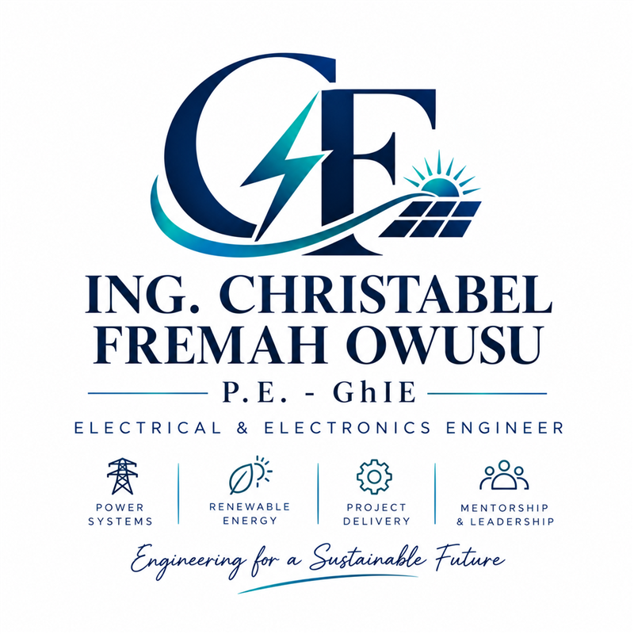
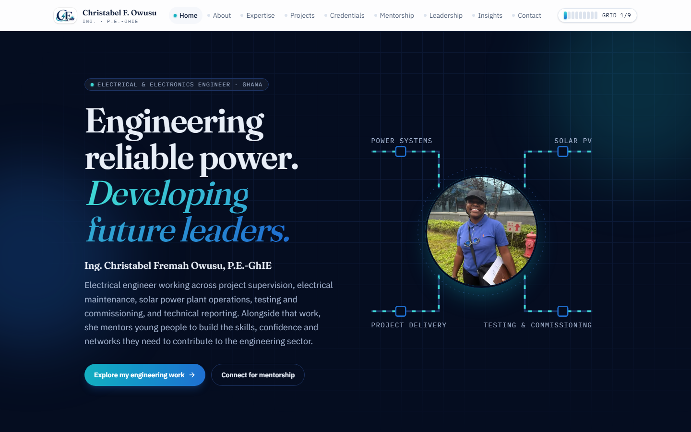
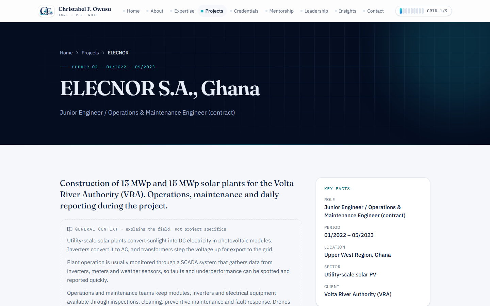
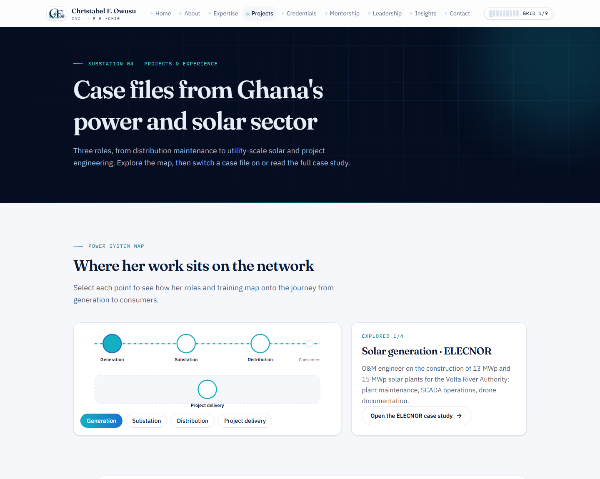
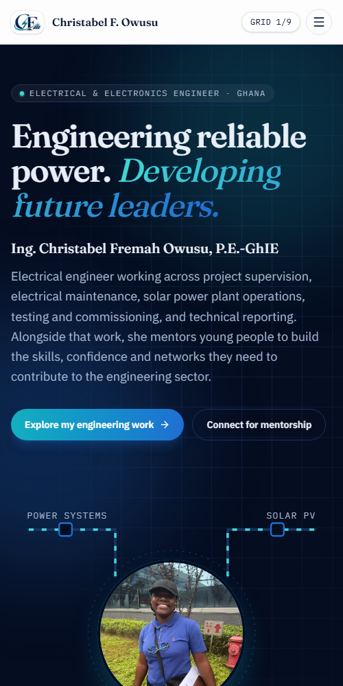

<div align="center">



# Ing. Christabel Fremah Owusu · P.E.-GhIE

**Electrical & Electronics Engineer · Power Systems · Renewable Energy · Mentor**

*Engineering for a Sustainable Future*

[](https://nextjs.org)
[](https://www.typescriptlang.org)
[](https://tailwindcss.com)
[](https://neon.tech)
[](https://vercel.com)

The professional website of a Ghanaian electrical engineer working in power distribution, utility-scale solar,
and electrical project delivery, and a mentor with
[EGA Mentorship International](https://www.egamentorship.org/).

</div>

<p align="center">
  
</p>

---

## Contents

- [Highlights](#highlights)
- [Screenshots](#screenshots)
- [Tech stack](#tech-stack)
- [Quick start](#quick-start)
- [Configuration](#configuration)
- [Project structure](#project-structure)
- [Editing content](#editing-content)
- [Deployment](#deployment)
- [Quality, security & privacy](#quality-security--privacy)
- [Content integrity](#content-integrity)

## Highlights

**A site built like a power network.** Every page is a *substation* that energises when you visit it. A grid meter in
the header tracks progress, a grid map doubles as navigation, and 11 achievements reward exploring the real content:
opening case files, reading training guides, exploring the power-system map and passing the student quiz.

| Area | What's there |
| --- | --- |
| **Home** | Animated single-line-diagram hero, career highlights, interactive project-lifecycle stepper, gallery, grid-game teaser |
| **Projects** | Clickable power-system map, case files with breaker-style toggles, and a **full case study** for each role |
| **Expertise** | Skills explorer (filter by source and role, search), evidence matrix of roles × skills, field primers |
| **Credentials** | Training journey across four countries, and a **training guide** for each course |
| **Mentorship** | EGA mentorship profile, a six-question *Grid readiness* quiz, a career-pathways guide and an FAQ |
| **Leadership** | Year-by-year timeline chart and leadership themes |
| **Insights** | MDX articles (ready for publishing), topic hubs and a searchable engineering glossary |
| **Contact** | Validated, spam-protected form saved to Postgres and emailed; enquiry guide and FAQ |

**21 statically generated pages**: the 9 main pages plus 3 case studies, 7 training guides, a career-pathways guide and a glossary,
plus illustrative SVG diagrams of solar plants, distribution networks, IEC 61850 substations and the project lifecycle.

## Screenshots

<table>
  <tr>
    <td width="50%"></td>
    <td width="50%"></td>
  </tr>
  <tr>
    <td align="center"><sub>Full case study</sub></td>
    <td align="center"><sub>Interactive power-system map</sub></td>
  </tr>
</table>

<p align="center">
  <br />
  <sub>Mobile</sub>
</p>

## Tech stack

| Layer | Choice |
| --- | --- |
| Framework | [Next.js 15](https://nextjs.org) App Router, React 19, TypeScript (strict) |
| Styling | [Tailwind CSS v4](https://tailwindcss.com) with brand tokens in `@theme`, `cn()` via `clsx` + `tailwind-merge` |
| Fonts & icons | Fraunces, IBM Plex Sans and IBM Plex Mono via `next/font`; [Lucide](https://lucide.dev) icons |
| Data | [Neon](https://neon.tech) serverless Postgres with [Drizzle ORM](https://orm.drizzle.team) (optional) |
| Forms | [Zod](https://zod.dev) validation shared by client and server, with email via [Web3Forms](https://web3forms.com) |
| Client data | [SWR](https://swr.vercel.app) |
| Content | Typed constants and MDX articles ([next-mdx-remote](https://github.com/hashicorp/next-mdx-remote)) |
| Hosting | [Vercel](https://vercel.com) free tier |

The codebase follows the conventions in [`nextjs-llm-instructions.md`](nextjs-llm-instructions.md):
- Tailwind utilities only.
- One default-exported component per file, and no file over 200 lines.
- Thin pages, with business logic in `lib/` and shared types in `types/`.

## Quick start

You need **Node.js 20.9+** (on Windows: `winget install OpenJS.NodeJS.LTS`).

```bash
git clone https://github.com/Richard-Mensah/chrisTa.git
cd chrisTa
npm install
cp .env.example .env.local   # fill in the values below
npm run dev                  # → http://localhost:3000
```

The site runs fully **without** any keys. Game progress falls back to browser storage, and the contact form shows a
clear "email directly" message until a database or email key is configured.

| Script | Purpose |
| --- | --- |
| `npm run dev` | Dev server with hot reload. Shows dashed "awaiting confirmation" tags on unverified content |
| `npm run build` / `npm start` | Production build and server (the pending tags are hidden) |
| `npm run check` | Lint, type-check and build in one go |
| `npm run check:links` | Crawl a running server for broken internal links |
| `npm run db:generate` | Create a migration after editing `lib/dbSchema.ts` |
| `npm run db:migrate` | Apply migrations to `DATABASE_URL` |
| `npm run db:studio` | Browse enquiries and data in Drizzle Studio |

## Configuration

| Variable | Needed | Purpose |
| --- | --- | --- |
| `NEXT_PUBLIC_SITE_URL` | Production | Public URL without a trailing slash. Used for canonical URLs, the sitemap and social cards |
| `DATABASE_URL` | Recommended | Neon **pooled** connection string |
| `NEXT_PUBLIC_WEB3FORMS_KEY` | Recommended | Emails each enquiry to Christabel's inbox |
| `IP_HASH_SALT` | With a database | Long random string. IPs are stored only as salted hashes, for rate limiting |

> The Web3Forms access key is public by design: it can only deliver to the inbox it was issued for. Real secrets
> (`DATABASE_URL`, `IP_HASH_SALT`) are server-only. Never commit `.env.local`.

<details>
<summary><b>Database setup (Neon)</b></summary>

1. Create a free project at [console.neon.tech](https://console.neon.tech) and copy the **pooled** connection string into `DATABASE_URL`.
2. Run `npm run db:migrate`. This creates four tables:

| Table | Holds |
| --- | --- |
| `contact_submissions` | Enquiries from the contact form |
| `visitors` | Anonymous IDs (cookie `cfo_vid`, no personal data) |
| `visitor_progress` | Grid signals such as `page:about` or `deep:elecnor` |
| `visitor_achievements` | Achievements, re-derived **on the server** so they can't be forged |

To read enquiries, run this in Neon's SQL editor or Drizzle Studio:

```sql
select created_at, name, email, organisation, category, message
from contact_submissions order by created_at desc;
```

To keep data lean, prune it occasionally:

```sql
delete from visitors where last_seen < now() - interval '12 months';
delete from contact_submissions where created_at < now() - interval '24 months' and handled;
```

</details>

<details>
<summary><b>How a contact message flows</b></summary>

1. The browser validates the form with the shared Zod schema.
2. `POST /api/contact` re-validates it and checks the honeypot, the minimum fill time and the per-IP rate limit (3 per 10 minutes).
3. If the checks pass, the message is saved to Neon.
4. The browser relays the email copy to Web3Forms. Its free plan accepts browser submissions only.

When the database is configured, a message is never lost, even if email delivery fails.

</details>

## Project structure

```
app/                    routes, API handlers, icons, OG image, sitemap, robots, manifest
  experience/[id]/        full case studies
  credentials/[id]/       training guides
  mentorship/pathways/    career-pathways guide
  insights/glossary/      engineering glossary
components/
  ui/                     presentational atoms (Button, Card, Section, Photo, Accordion…)
  layout/                 Navbar, MobileMenu, Footer
  features/               home, about, expertise, experience, credentials, mentorship,
                          leadership, insights, contact, gallery, diagrams, grid (game)
hooks/                  useGrid, useGridState, useContactForm, useQuiz, useLightbox…
lib/                    cn() & helpers, Zod schemas, db + schema, contact/progress logic, SEO
types/                  shared TypeScript types
constants/              all site content and settings: edit text here
content/insights/       MDX articles
drizzle/                SQL migrations
public/                 images, logo and PWA icons
```

## Editing content

All copy lives in typed files in [`constants/`](constants), so you rarely need to touch a component.

| File | Controls |
| --- | --- |
| `site.ts` | Name, credentials line, tagline, email visibility, LinkedIn URL |
| `content.ts` · `home.ts` · `about.ts` | Hero text, biography, timeline, highlights, lifecycle, affiliations, map hotspots |
| `experience.ts` · `caseStudies.ts` | Roles and their full case studies (add verified results to `outcomes`) |
| `credentials.ts` · `trainingGuides.ts` | Registration, education, training, and the guide pages |
| `expertise.ts` | Skill groups, each tagged `experience`, `tool` or `training` |
| `leadership.ts` | Roles, themes, and optional speaking, conference and community lists (hidden while empty) |
| `mentorship.ts` · `quiz.ts` · `faq.ts` · `pathways.ts` | Mentorship copy, the quiz, FAQs and career pathways |
| `glossary.ts` · `insights.ts` | Glossary terms and Insights topic hubs |
| `photos.ts` | Image paths, alt text and captions |

Each item carries a `status` and a `published` flag:
- `published: false` hides an item.
- `status: "needs-confirmation"` shows a dashed tag in development only.

Adding a role or a training guide automatically adds its page and its sitemap entry.

**Publishing an article:**
1. Copy `content/insights/_template.mdx` to `content/insights/<slug>.mdx`.
2. Fill in the frontmatter and remove `draft: true`.
3. Commit. The listing, reading time, social metadata and Article JSON-LD are generated for you.

**Adding a photo:**
1. Add a web-sized JPEG (about 1600 px on the long edge) to `public/images/`.
2. Register it in `photos.ts` with descriptive alt text.
3. Only use photos with consent from everyone pictured.

## Deployment

1. Import the repository in **Vercel → Add New → Project**. The default Next.js settings work as-is.
2. Add the environment variables above for *Production* (and *Preview* if wanted), then deploy.
3. Run `npm run db:migrate` once against the production `DATABASE_URL`.
4. **Custom domain:** in Vercel, go to *Settings → Domains*, add the domain and follow the DNS instructions. Then set `NEXT_PUBLIC_SITE_URL` and redeploy.
5. Submit `https://<domain>/sitemap.xml` in **Google Search Console**. This helps Google pick up the pages and the CF favicon in search results.

## Quality, security & privacy

- **Accessibility:**
  - Semantic landmarks, a skip link and one `h1` per page.
  - Visible focus states, and keyboard-operable toggles, tabs, dialogs and the lightbox.
  - `aria-live` feedback, and form errors linked to their fields.
  - Every animation is disabled under `prefers-reduced-motion`.
  - The game layer can be hidden.
- **SEO:**
  - Unique titles, descriptions and canonical URLs.
  - Open Graph and Twitter cards, plus a generated social image carrying the logo.
  - Sitemap and robots files.
  - JSON-LD for Person, WebSite, BreadcrumbList, FAQPage, DefinedTermSet and Article.
  - A full favicon and PWA icon set built from the CF logo.
- **Security:**
  - CSP, HSTS, `X-Frame-Options: DENY`, `nosniff`, Referrer-Policy and Permissions-Policy.
  - Validation on both client and server, plus rate limiting.
  - No secrets in client code.
- **Privacy:**
  - No analytics or third-party trackers.
  - The email address is assembled in the browser.
  - IPs are stored only as salted hashes.
  - Phone numbers and referees are never published.
  - Source files such as the CV are gitignored.

## Content integrity

Everything this site says about Christabel comes from her CV.
- Explanations of how a field works (solar O&M, IEC 61850, factory acceptance tests and so on) appear in clearly labelled **General context** notes, so they're never mistaken for claims about specific projects.
- Diagrams are captioned *illustrative, not project drawings*.
- Items that still need her sign-off are listed in [`CONFIRM-BEFORE-LAUNCH.md`](CONFIRM-BEFORE-LAUNCH.md).

---

<div align="center">
<sub>© Christabel Fremah Owusu. The site content, photographs and logo are not licensed for reuse.</sub>
</div>
